# Catálogo de Produtos com MongoDB

Trabalho Avaliativo — Bancos de Dados NoSQL · **Grupo: Documentos**

Estudo de caso: **catálogo de produtos com atributos diferentes por categoria (celular, roupa, livro) e avaliações dos clientes**.

> **Por que MongoDB e não CouchDB ou Firestore?** Porque roda local via Docker sem conta em nuvem (o Firestore depende do Google Cloud), e já traz pipeline de agregação, busca textual em português e validação de esquema, enquanto no CouchDB agregações dependem de views MapReduce e a busca textual de um serviço à parte.

---

## Estrutura do repositório

```
├── docker-compose.yml          → MongoDB (+ PostgreSQL opcional para o comparativo)
├── init/                       → roda sozinho na 1ª subida do container
│   ├── 01-schema.js            → coleções, validação $jsonSchema e índices
│   └── 02-carga.js             → 15 clientes, 32 produtos, 91 avaliações
├── scripts/                    → demonstração
│   ├── 01-crud.js              → inserir, consultar, atualizar, excluir
│   ├── 02-consultas.js         → 8 consultas do estudo de caso
│   └── 03-ponto-forte.js       → documento aninhado, atomicidade, esquema flexível
├── sql/                        → comparativo relacional (PostgreSQL)
│   ├── init/01-schema.sql      → 11 tabelas
│   ├── init/02-carga.sql       → mesmos dados do MongoDB
│   ├── consultas.sql           → Q1 e Q4 em SQL (+ página do produto)
│   └── gerar-carga-sql.js      → gera a carga SQL a partir do MongoDB
└── docs/
    ├── modelagem.md            → desenho dos documentos e perguntas do sistema
    ├── comparativo-relacional.md → diagrama ER, consultas e conclusão
    ├── roteiro-apresentacao.md → divisão da demo de 15 min + perguntas prováveis
    └── prints/                 → resultado de cada consulta
```

---

## 1. Subindo o ambiente do zero

**Pré-requisito:** [Docker Desktop](https://www.docker.com/products/docker-desktop/) instalado e aberto (Windows, Mac ou Linux).

```bash
# 1) Baixar o projeto
git clone https://github.com/GabaDevPro/catalogo-mongodb.git
cd catalogo-mongodb

# 2) Subir o MongoDB (na 1ª vez ele já cria as coleções e faz a carga)
docker compose up -d

# 3) Conferir se a carga rodou (deve mostrar 32 e 15)
docker exec -it catalogo-mongo mongosh catalogo --quiet --eval "db.produtos.countDocuments() + ' produtos / ' + db.clientes.countDocuments() + ' clientes'"
```

Se aparecer `0 produtos`, o container ainda está subindo: espere uns 10 segundos e rode de novo.

### Rodando a demonstração

```bash
docker exec -it catalogo-mongo mongosh catalogo /scripts/01-crud.js
docker exec -it catalogo-mongo mongosh catalogo /scripts/02-consultas.js
docker exec -it catalogo-mongo mongosh catalogo /scripts/03-ponto-forte.js
```

Para abrir o terminal do banco e digitar comandos na mão:

```bash
docker exec -it catalogo-mongo mongosh catalogo
```

Para ver os documentos de forma visual, abra o **MongoDB Compass** (gratuito) e conecte em `mongodb://localhost:27017`.

### Recarregar os dados originais

```bash
docker exec -it catalogo-mongo mongosh catalogo /docker-entrypoint-initdb.d/01-schema.js
docker exec -it catalogo-mongo mongosh catalogo /docker-entrypoint-initdb.d/02-carga.js
```

Ou apagar tudo e subir de novo: `docker compose down -v` e depois `docker compose up -d`.

### Comparativo: subindo o PostgreSQL

```bash
docker compose --profile sql up -d
docker exec -it catalogo-postgres psql -U aluno -d catalogo -f /sql/consultas.sql
```

---

## 2. Modelagem

Detalhes completos em **[docs/modelagem.md](docs/modelagem.md)**. Resumo:

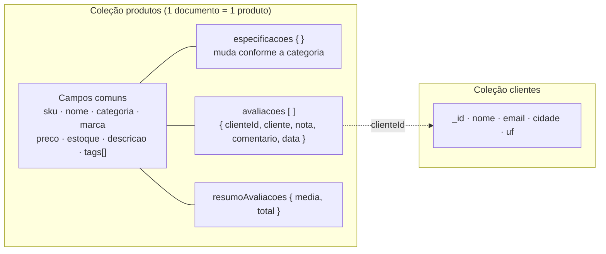

- **Uma coleção para todos os produtos**, com os campos comuns na raiz.
- **`especificacoes`** guarda o que muda por categoria (RAM do celular, grade de tamanhos da roupa, autores do livro).
- **Avaliações aninhadas** no produto, porque são sempre lidas junto com ele.
- **`resumoAvaliacoes`** guarda média e total já calculados, para ordenar "mais bem avaliados" sem recalcular.
- **Validação `$jsonSchema`** exige os campos comuns e nota inteira de 1 a 5.

| # | Pergunta do sistema | Como a modelagem ajuda |
|---|---|---|
| Q1 | Celulares 5G, 8GB+ de RAM, até R$ 3.000 | filtra atributos de celular e preço no mesmo documento (índice `categoria_preco`) |
| Q2 | Livros de um autor | `autores` é array com índice multikey |
| Q3 | Roupas com tamanho M disponível | grade dentro do produto + `$elemMatch` |
| Q4 | Top 5 mais bem avaliados | média pré-calculada + índice `melhor_avaliados` |
| Q5 | Nota média por categoria | `$unwind` + `$group` nas avaliações aninhadas |
| Q6 | Reclamações recentes (nota ≤ 2) | avaliação já traz produto e cliente juntos |
| Q7 | Busca "camiseta algodão" | índice de texto em português |
| Q8 | Marcas mais bem avaliadas | agregação sobre as avaliações |

---

## 3. Carga e operações

- **Carga:** [`init/02-carga.js`](init/02-carga.js) — 32 produtos reais do mercado brasileiro (10 celulares, 10 roupas, 12 livros), 15 clientes e 91 avaliações.
- **CRUD:** [`scripts/01-crud.js`](scripts/01-crud.js) — `insertOne`, `insertMany`, `findOne`, `find`, `updateOne` (inclusive dentro do array com o operador `$`), `updateMany`, `deleteOne`, `deleteMany`.

| Inserir | Consultar |
|---|---|
| 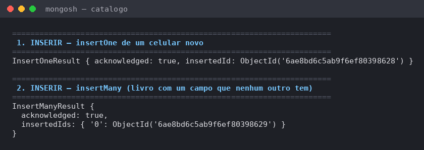 | 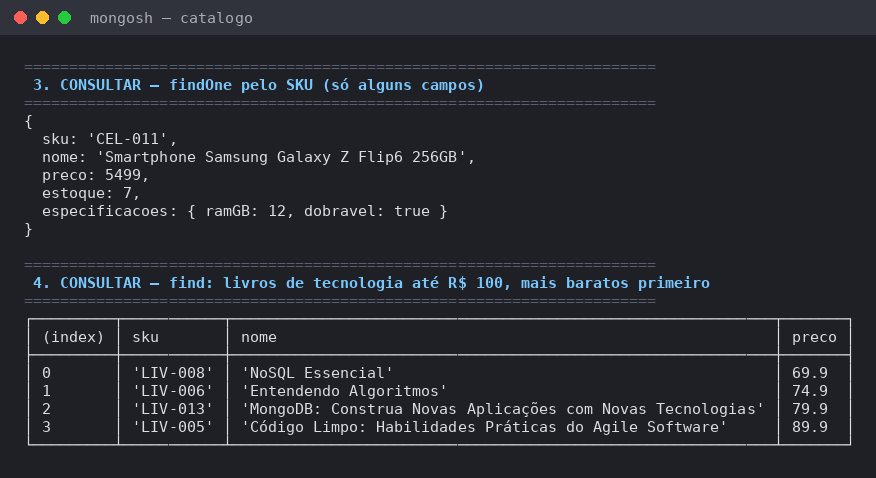 |
| **Atualizar** | **Excluir** |
| 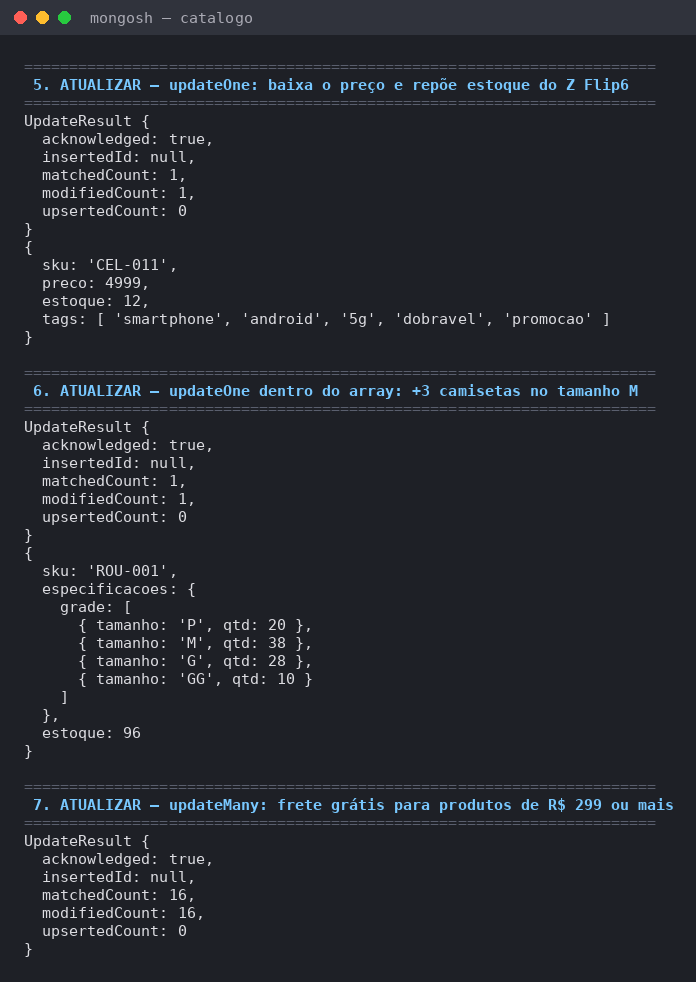 | 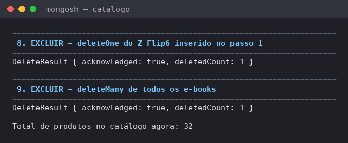 |

## 4. Consultas do estudo de caso

[`scripts/02-consultas.js`](scripts/02-consultas.js) — 8 consultas. A função `mostrar()` só formata o resultado como tabela; o comando do banco é o que está dentro dela. Saída completa em texto: [`docs/prints/saida-consultas.txt`](docs/prints/saida-consultas.txt).

#### Q1. Celulares 5G com 8GB+ de RAM até R$ 3.000 (mais baratos primeiro)

```js
const filtroQ1 = {
  categoria: "celular",
  preco: { $lte: 3000 },
  "especificacoes.suporta5G": true,
  "especificacoes.ramGB": { $gte: 8 }
};
mostrar(db.produtos.find(filtroQ1,
  { _id: 0, nome: 1, preco: 1, "especificacoes.ramGB": 1, "especificacoes.armazenamentoGB": 1 }
).sort({ preco: 1 }));
```

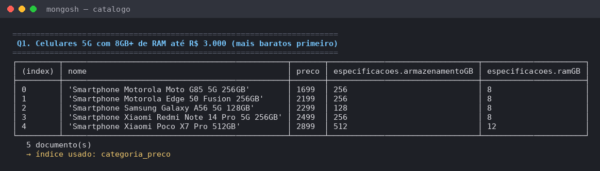

#### Q2. Livros de Machado de Assis

```js
const filtroQ2 = { "especificacoes.autores": "Machado de Assis" };
mostrar(db.produtos.find(filtroQ2,
  { _id: 0, nome: 1, preco: 1, "especificacoes.anoPublicacao": 1, "resumoAvaliacoes.media": 1 }
).sort({ "especificacoes.anoPublicacao": 1 }));
```

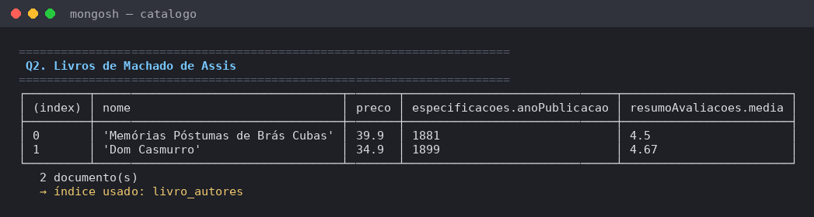

#### Q3. Roupas que têm o tamanho M disponível

```js
db.produtos.find(
  { categoria: "roupa", "especificacoes.grade": { $elemMatch: { tamanho: "M", qtd: { $gt: 0 } } } },
  { _id: 0, nome: 1, preco: 1, "especificacoes.grade.$": 1 }
).sort({ preco: 1 })
```

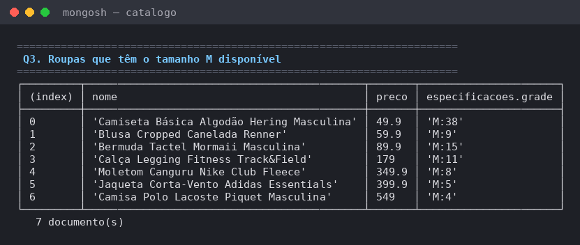

#### Q4. Top 5 produtos mais bem avaliados (com pelo menos 3 avaliações)

```js
db.produtos.find(
  { "resumoAvaliacoes.total": { $gte: 3 } },
  { _id: 0, nome: 1, categoria: 1, resumoAvaliacoes: 1 }
).sort({ "resumoAvaliacoes.media": -1, "resumoAvaliacoes.total": -1, nome: 1 }).limit(5)
```

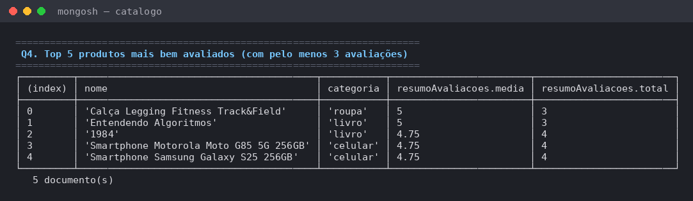

#### Q5. Nota média e quantidade de avaliações por categoria

```js
db.produtos.aggregate([
  { $unwind: "$avaliacoes" },
  { $group: {
      _id: "$categoria",
      notaMedia:        { $avg: "$avaliacoes.nota" },
      totalAvaliacoes:  { $sum: 1 },
      produtosAvaliados:{ $addToSet: "$sku" }
  } },
  { $project: {
      _id: 0,
      categoria: "$_id",
      notaMedia: { $round: ["$notaMedia", 2] },
      totalAvaliacoes: "$totalAvaliacoes",
      produtosAvaliados: { $size: "$produtosAvaliados" }
  } },
  { $sort: { notaMedia: -1 } }
])
```

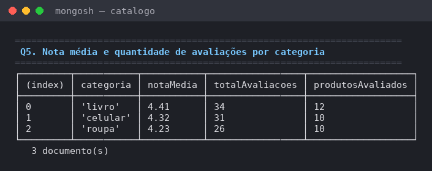

#### Q6. Reclamações recentes: avaliações com nota ≤ 2 desde agosto/2026

```js
db.produtos.aggregate([
  { $match: { avaliacoes: { $elemMatch: { nota: { $lte: 2 }, data: { $gte: ISODate("2026-08-01") } } } } },
  { $unwind: "$avaliacoes" },
  { $match: { "avaliacoes.nota": { $lte: 2 }, "avaliacoes.data": { $gte: ISODate("2026-08-01") } } },
  { $project: {
      _id: 0,
      produto: "$nome",
      cliente: "$avaliacoes.cliente",
      nota: "$avaliacoes.nota",
      comentario: "$avaliacoes.comentario",
      data: { $dateToString: { format: "%d/%m/%Y", date: "$avaliacoes.data" } },
      dataOrdem: "$avaliacoes.data"
  } },
  { $sort: { dataOrdem: -1 } },
  { $unset: "dataOrdem" }
])
```

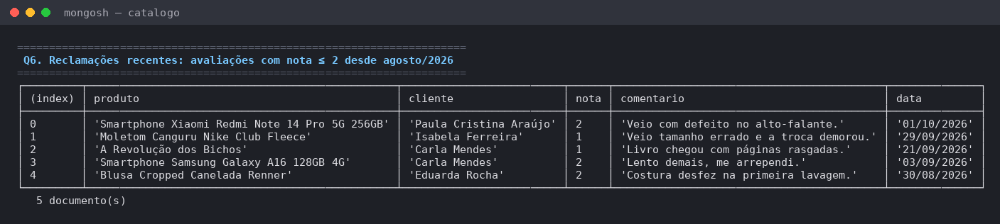

#### Q7. Busca na barra do site: "camiseta algodão" (ordenada por relevância)

```js
db.produtos.find(
  { $text: { $search: "camiseta algodão" } },
  { _id: 0, nome: 1, preco: 1, relevancia: { $meta: "textScore" } }
).sort({ relevancia: { $meta: "textScore" } }).limit(5)
```

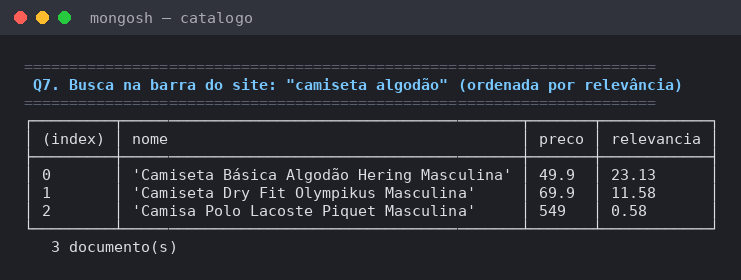

#### Q8. Marcas com melhor avaliação média (mínimo 5 avaliações)

```js
db.produtos.aggregate([
  { $unwind: "$avaliacoes" },
  { $group: { _id: "$marca", media: { $avg: "$avaliacoes.nota" }, avaliacoes: { $sum: 1 } } },
  { $match: { avaliacoes: { $gte: 5 } } },
  { $project: { _id: 0, marca: "$_id", media: { $round: ["$media", 2] }, avaliacoes: "$avaliacoes" } },
  { $sort: { media: -1 } }
])
```

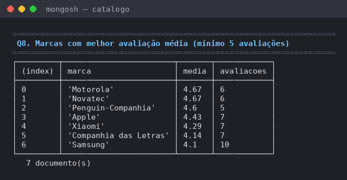

### Ponto forte do tipo Documentos

[`scripts/03-ponto-forte.js`](scripts/03-ponto-forte.js):

- **A) Documento aninhado:** a página do produto (dados + especificações + últimas avaliações) sai em **1 leitura e 0 JOINs**.
- **B) Atomicidade no documento:** a nova avaliação entra e a média é recalculada numa única `updateOne`.
- **C) Flexível com regras:** avaliação com nota 7 é recusada pela validação.
- **D) Categoria nova sem migração:** um fone de ouvido entra na mesma coleção com outros campos.

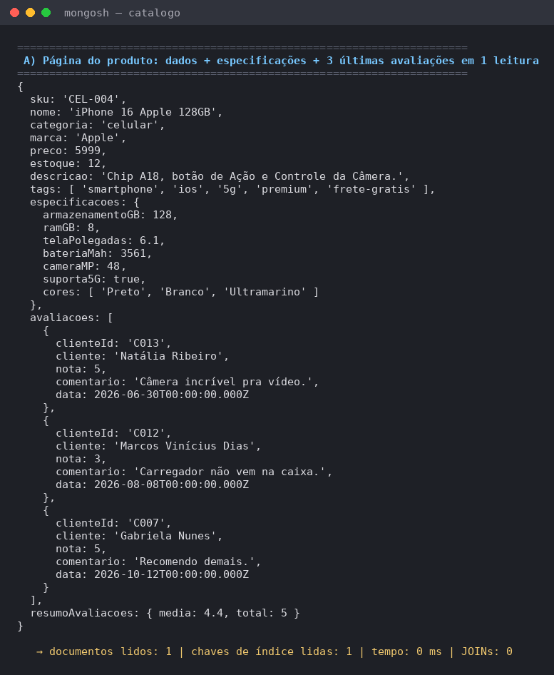

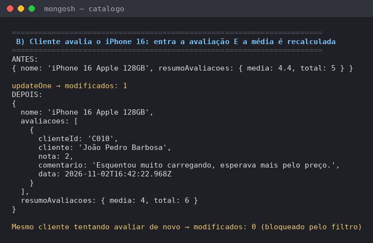

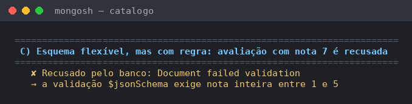

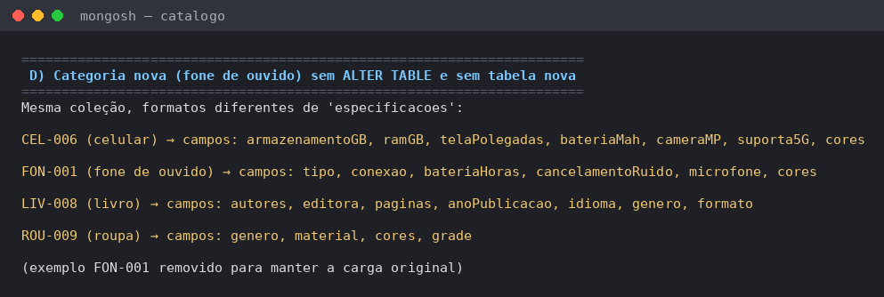

## 5. Comparativo com o relacional

Diagrama ER, tabelas, consultas Q1 e Q4 em SQL e a conclusão: **[docs/comparativo-relacional.md](docs/comparativo-relacional.md)**.

**Conclusão em uma frase:** para o catálogo, o MongoDB ganha (2 coleções contra 11 tabelas, página do produto sem JOIN, categoria nova sem migração); para pedidos e pagamentos, o relacional continua sendo a melhor escolha.
