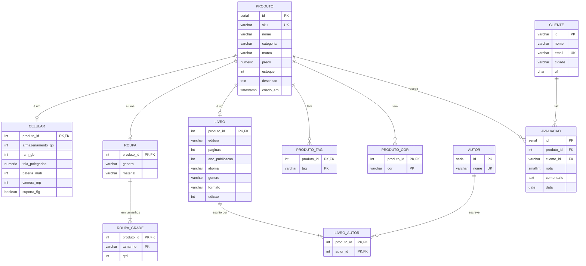
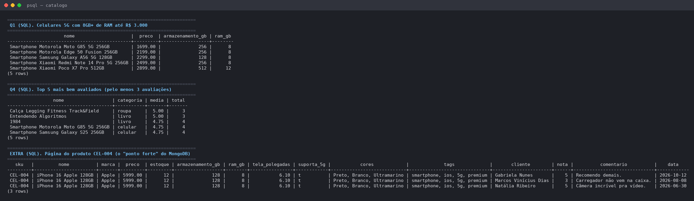

# Comparativo com o modelo relacional

O mesmo catálogo foi modelado no **PostgreSQL**, com **os mesmos dados** (a carga SQL é gerada a partir do MongoDB pelo script `sql/gerar-carga-sql.js`).

- Criação das tabelas: [`sql/init/01-schema.sql`](../sql/init/01-schema.sql)
- Carga: [`sql/init/02-carga.sql`](../sql/init/02-carga.sql)
- Consultas reescritas: [`sql/consultas.sql`](../sql/consultas.sql)

## Diagrama ER



A herança "produto → celular/roupa/livro" foi feita com **uma tabela por subtipo** (relação 1:1). É a forma normalizada mais comum; as alternativas seriam uma tabela única cheia de colunas `NULL` ou um modelo EAV (entidade-atributo-valor), que é flexível mas difícil de consultar e validar.

**Resultado: 2 coleções no MongoDB viram 11 tabelas no PostgreSQL.**

## Consultas lado a lado

### Q1 — Celulares 5G com 8GB+ de RAM até R$ 3.000

```js
// MongoDB
db.produtos.find({
  categoria: "celular", preco: { $lte: 3000 },
  "especificacoes.suporta5G": true, "especificacoes.ramGB": { $gte: 8 }
}).sort({ preco: 1 })
```

```sql
-- PostgreSQL
SELECT p.nome, p.preco, c.armazenamento_gb, c.ram_gb
FROM produto p
JOIN celular c ON c.produto_id = p.id
WHERE p.categoria = 'celular' AND p.preco <= 3000
  AND c.suporta_5g = TRUE AND c.ram_gb >= 8
ORDER BY p.preco;
```

Os dois retornam os mesmos 5 celulares. No SQL precisa de JOIN porque os atributos do celular estão em outra tabela.

### Q4 — Top 5 mais bem avaliados (mínimo 3 avaliações)

```js
// MongoDB — lê a média já guardada no documento
db.produtos.find({ "resumoAvaliacoes.total": { $gte: 3 } })
  .sort({ "resumoAvaliacoes.media": -1, "resumoAvaliacoes.total": -1, nome: 1 }).limit(5)
```

```sql
-- PostgreSQL — calcula a média na hora
SELECT p.nome, p.categoria, ROUND(AVG(a.nota), 2) AS media, COUNT(*) AS total
FROM produto p
JOIN avaliacao a ON a.produto_id = p.id
GROUP BY p.id, p.nome, p.categoria
HAVING COUNT(*) >= 3
ORDER BY media DESC, total DESC, p.nome
LIMIT 5;
```

Os dois retornam o mesmo top 5. No SQL a média é recalculada em toda consulta; no MongoDB ela foi calculada uma vez, quando a avaliação entrou.

### Extra — Página do produto

No MongoDB é um `findOne({ sku: "CEL-004" })`: **1 documento lido, 0 JOINs**. No PostgreSQL a mesma página junta `produto`, `celular`, `avaliacao`, `cliente`, `produto_cor` e `produto_tag`, e o resultado volta repetido (uma linha por avaliação), cabendo à aplicação reagrupar.

Resultado das consultas no PostgreSQL:



## Neste caso, qual modelo é melhor, e por quê?

Para **o catálogo de produtos com avaliações, o modelo de documentos (MongoDB) é o melhor**, por três motivos ligados ao próprio caso.

Primeiro, **os produtos não têm o mesmo formato**. Celular tem RAM e tela, roupa tem grade de tamanhos, livro tem autores e editora. No relacional isso virou uma tabela por categoria, mais tabelas para cada lista (cores, tags, grade, autores): 11 tabelas no total. Uma categoria nova (fone de ouvido, por exemplo) exige `CREATE TABLE`, alterar o `CHECK` da categoria e mudar as consultas. No MongoDB basta inserir o documento com outros campos em `especificacoes`, como o script `03-ponto-forte.js` demonstra.

Segundo, **o acesso mais comum do e-commerce é "abrir a página do produto"**, e ela precisa de tudo junto: dados, especificações e avaliações. No documento isso é uma única leitura; no relacional são vários JOINs a cada visita. Como produtos são muito mais lidos do que alterados, compensa organizar os dados do jeito que eles são lidos.

Terceiro, **a avaliação e a média ficam consistentes sem transação**: incluir a avaliação e recalcular `resumoAvaliacoes` é uma única `updateOne`, atômica no documento.

O relacional continua sendo melhor em outras partes de uma loja. **Pedidos, pagamentos e estoque financeiro** pedem transações entre várias tabelas, integridade referencial forte e relatórios com muitos cruzamentos, que é onde o SQL brilha. Mesmo no catálogo, o SQL é mais simples para perguntas "atravessadas", como "todas as avaliações de um cliente", e garante por chave estrangeira que o cliente da avaliação existe. Por isso a conclusão do grupo é: **MongoDB para o catálogo, relacional para o que envolve dinheiro**. É comum lojas reais usarem os dois juntos.
