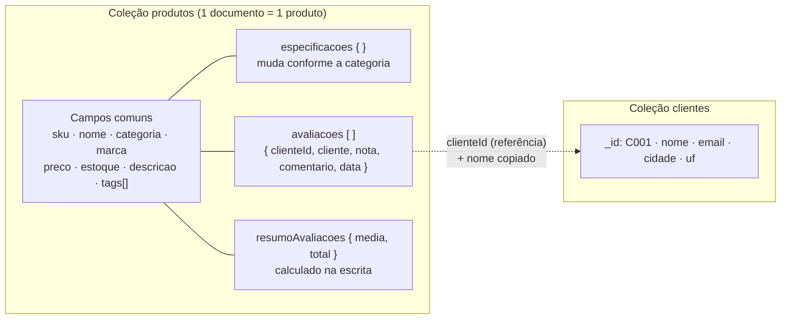

# Modelagem no MongoDB

## Visão geral

O banco `catalogo` tem **2 coleções**:

| Coleção    | O que guarda                                                        | Qtde na carga |
|------------|---------------------------------------------------------------------|---------------|
| `produtos` | o produto inteiro: dados comuns, especificações da categoria e avaliações | 32 documentos (91 avaliações dentro) |
| `clientes` | cadastro de quem avalia                                              | 15 documentos |



## Como fica um documento

Um celular e um livro **na mesma coleção**, com formatos diferentes em `especificacoes`:

```js
{
  sku: "CEL-006",
  nome: "Smartphone Motorola Moto G85 5G 256GB",
  categoria: "celular",
  marca: "Motorola",
  preco: 1699,
  estoque: 55,
  tags: ["smartphone", "android", "5g", "intermediario"],
  especificacoes: {                       // ← atributos de CELULAR
    armazenamentoGB: 256, ramGB: 8, telaPolegadas: 6.67,
    bateriaMah: 5000, cameraMP: 50, suporta5G: true,
    cores: ["Azul", "Grafite", "Verde"]
  },
  avaliacoes: [                           // ← avaliações ANINHADAS
    { clienteId: "C002", cliente: "Bruno Henrique Lima", nota: 5,
      comentario: "Melhor custo-benefício da Motorola.", data: ISODate("2026-01-30") },
    // ...
  ],
  resumoAvaliacoes: { media: 4.75, total: 4 }
}

{
  sku: "LIV-008",
  nome: "NoSQL Essencial",
  categoria: "livro",
  // ...
  especificacoes: {                       // ← atributos de LIVRO (outros campos!)
    autores: ["Pramod J. Sadalage", "Martin Fowler"],
    editora: "Novatec", paginas: 220, anoPublicacao: 2013,
    idioma: "português", genero: "tecnologia", formato: "brochura"
  },
  avaliacoes: [ /* ... */ ],
  resumoAvaliacoes: { media: 4.33, total: 3 }
}
```

Uma roupa tem a **grade de tamanhos** como array de subdocumentos:

```js
especificacoes: {
  genero: "masculino", material: "100% algodão", cores: ["Preto", "Branco", "Cinza"],
  grade: [ { tamanho: "P", qtd: 20 }, { tamanho: "M", qtd: 35 }, { tamanho: "G", qtd: 28 }, { tamanho: "GG", qtd: 10 } ]
}
```

## Decisões de modelagem (e o porquê de cada uma)

| Decisão | Por quê |
|---|---|
| **Uma coleção só para todos os produtos** | O site lista, busca e ordena produtos de todas as categorias juntos (busca, "mais bem avaliados"). Separar por categoria obrigaria a juntar coleções. |
| **Atributos específicos dentro de `especificacoes`** (padrão *polimórfico*) | Cada categoria tem campos diferentes. Guardar num subdocumento evita colunas vazias e não exige mudar esquema para categoria nova. |
| **Avaliações aninhadas no produto** (*embedding*) | Avaliação é sempre lida junto com o produto (página do produto). Uma leitura traz tudo, e a inclusão da avaliação é atômica no documento. |
| **`resumoAvaliacoes` pré-calculado** (padrão *computed*) | "Mais bem avaliados" é uma consulta frequente. Calcular a média na escrita (que é rara) deixa a leitura (frequente) barata e indexável. |
| **No review, `clienteId` + nome copiado** (*referência estendida*) | A página mostra o nome do cliente sem precisar consultar `clientes`. O id continua lá para buscar o cadastro completo quando precisar. |
| **Clientes em coleção separada** (*referência*) | Cliente existe independente de produto e avalia vários produtos; repetir o cadastro inteiro em cada avaliação seria desperdício. |
| **Validação `$jsonSchema`** | Esquema flexível não é esquema solto: o banco exige os campos comuns e nota inteira de 1 a 5. |

**Cuidado conhecido:** um documento do MongoDB tem limite de 16 MB. Um produto com dezenas de milhares de avaliações poderia chegar perto disso. Para um catálogo de loja pequena/média isso está longe de acontecer; num marketplace gigante, a solução seria guardar só as últimas N avaliações no produto (padrão *subset*) e o histórico completo numa coleção `avaliacoes`.

## Perguntas que o sistema responde e como a modelagem ajuda

| # | Pergunta | Como a modelagem facilita | Índice |
|---|---|---|---|
| Q1 | Quais celulares 5G com 8GB+ de RAM custam até R$ 3.000? | Filtra campos de celular (`especificacoes.*`) e campos comuns (`preco`) no mesmo documento, sem JOIN | `categoria_preco` |
| Q2 | Quais livros são de Machado de Assis? | `autores` é array: o MongoDB procura dentro dele direto, sem tabela livro_autor | `livro_autores` (multikey) |
| Q3 | Quais roupas têm tamanho M disponível? | A grade está no próprio produto; `$elemMatch` garante que o MESMO item é "M" e tem qtd > 0 | `categoria_preco` |
| Q4 | Quais são os 5 produtos mais bem avaliados? | Média já calculada no documento: é só ordenar | `melhor_avaliados` |
| Q5 | Qual a nota média de cada categoria? | `$unwind` abre as avaliações aninhadas e `$group` agrupa por categoria | — |
| Q6 | Quais reclamações (nota ≤ 2) chegaram desde agosto? | Avaliação já vem com nome do produto e do cliente juntos, pronto para o SAC | — |
| Q7 | O que aparece se o cliente buscar "camiseta algodão"? | Índice de texto em português sobre nome, tags e descrição, com peso maior no nome | `busca_texto` |
| Q8 | Quais marcas têm melhor avaliação média? | Pipeline de agregação sobre as avaliações aninhadas | — |
| ★ | Montar a página de um produto | **1 leitura, 0 JOINs**: dados, especificações e avaliações no mesmo documento | `sku_unico` |

**Pergunta que o modelo NÃO favorece:** "todas as avaliações feitas pelo cliente C003". Como as avaliações estão espalhadas dentro dos produtos, é preciso `$unwind` em vários documentos. Funciona bem com 32 produtos, mas em escala exigiria um índice em `avaliacoes.clienteId` ou a coleção separada de avaliações. Escolhemos otimizar para a leitura que o e-commerce mais faz: a página do produto.
